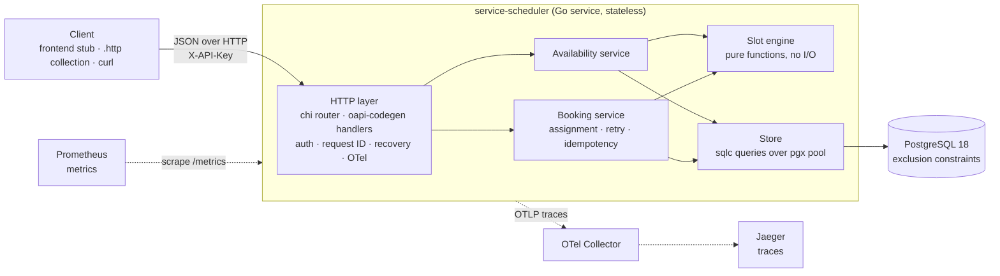
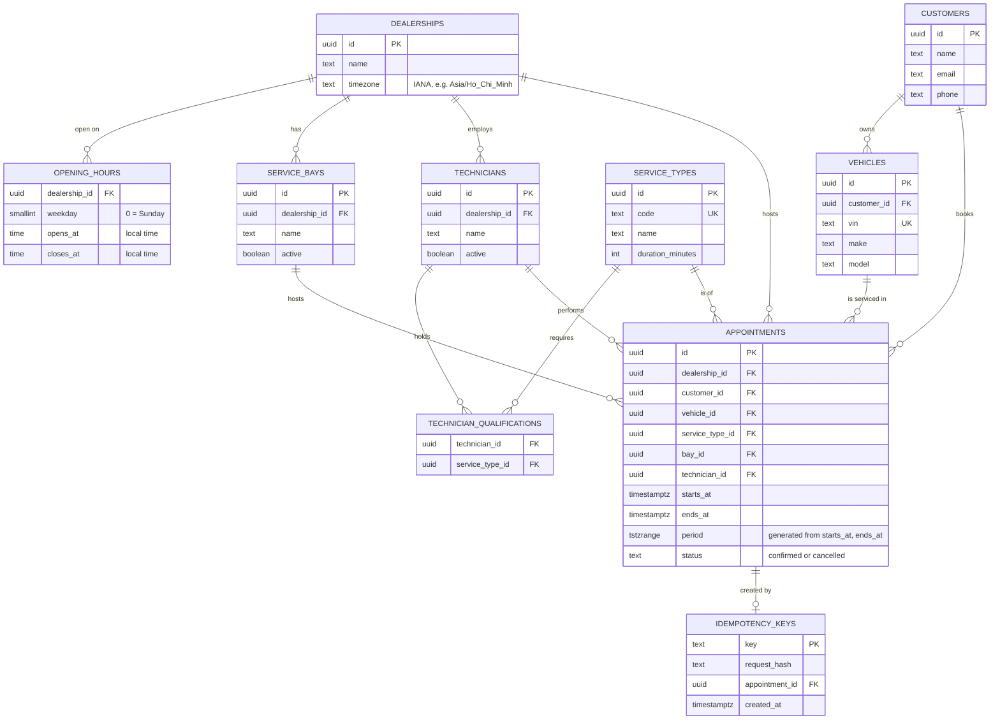
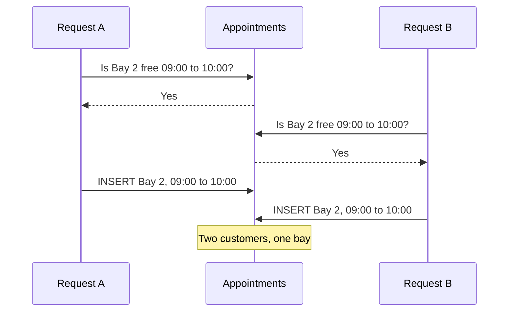
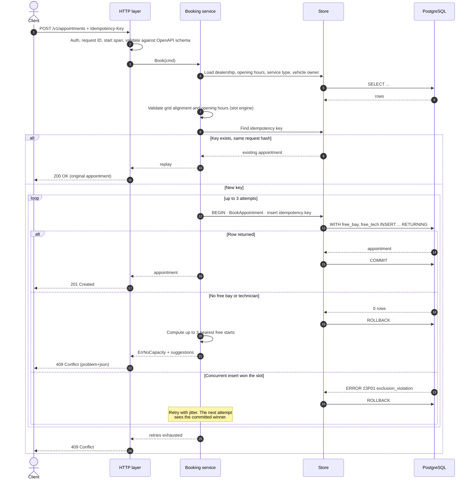
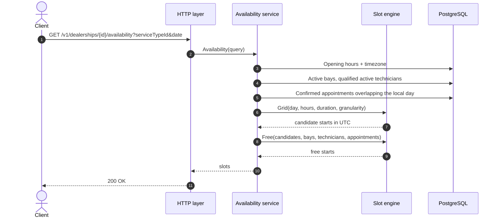

# Unified Service Scheduler: System Design

| | |
|---|---|
| **Scenario** | A, The Unified Service Scheduler (Ownership domain) |
| **Implemented layer** | Backend (REST API + PostgreSQL). Frontend stubbed with the OpenAPI spec and a `.http` request collection |
| **Author** | Pyae Thu Aung |
| **Status** | Draft v1 |

---

## 1. Overview

Dealerships book service appointments by phone, spreadsheet or paper diary. Two advisors can promise the same lift, or the same technician, to two customers at 10:00 on a Tuesday, and nobody finds out until both cars arrive.

This service replaces that with an API that books an appointment only when a **service bay** and a **qualified technician** are both free for the **whole** service duration, and guarantees that no bay or technician is ever double-booked, even when many requests race for the same slot.

### 1.1 Requirements

| ID | Requirement | Source |
|---|---|---|
| FR1 | Request an appointment for a vehicle, service type and dealership at a desired start time | Brief, core requirement 1 |
| FR2 | Before confirming, check that a service bay and a qualified technician are both free for the entire service duration | Brief, core requirement 2 |
| FR3 | On success, persist an appointment linking customer, vehicle, technician and service bay | Brief, core requirement 3 |
| FR4 | List available start times for a dealership, service type and date, so a client can offer valid slots | Supporting, needed for a usable booking UX |
| FR5 | Cancel an appointment and release its bay and technician | Supporting, keeps capacity accurate |
| NFR1 | **No double booking under concurrency.** Exactly one of N simultaneous requests for the last free slot succeeds | Correctness |
| NFR2 | Safe client retries: a retried booking request never creates a second appointment | Reliability |
| NFR3 | Logs, metrics and traces for every request, with booking outcomes visible as metrics | Observability |
| NFR4 | Stateless API that scales horizontally without changing the correctness guarantee | Scalability |

### 1.2 Out of scope

Payments, notifications (email/SMS), customer authentication, technician shift rosters and leave, rescheduling (modelled as cancel and rebook), multi-day jobs, and parts availability. Section 13 covers how each would be added.

---

## 2. Assumptions

The brief leaves these open. Each is a deliberate choice, and each can be changed without reworking the core design.

| # | Assumption | Why |
|---|---|---|
| A1 | Each **service type** has a fixed duration (for example, oil change 60 min, brake service 120 min). | The brief says "for the entire service duration", which implies the duration is known at booking time. |
| A2 | A technician is **qualified** for a service type through an explicit qualification record. | "Qualified technician" needs a concrete, queryable definition. |
| A3 | Service bays are interchangeable within a dealership. | Keeps FR2 to two resources. Bay capabilities (alignment rack, EV bay) are future work. |
| A4 | Each dealership has an IANA timezone and weekly opening hours. An appointment must start and end inside opening hours on one local day. | Dealerships are physical sites. Bookings that run past closing are not serviceable. |
| A5 | Technicians are available for all of their dealership's opening hours. | Shift rosters are out of scope. The design leaves a seam for them (Section 13). |
| A6 | The system **assigns** the bay and technician. The customer chooses only the time. | Customers book a service, not a person or a lift. Assignment also lets the system balance load. |
| A7 | Start times align to a 15-minute grid. | Matches how workshops plan. Configurable via `SLOT_GRANULARITY`. |
| A8 | "Real-time availability check" means checked at request time against committed data and enforced at write time. No availability cache. | A cache would reintroduce the race the feature exists to remove. |
| A9 | Customers and vehicles already exist (seeded). The booking request references them by ID. | Customer and vehicle management belong to other domains. |
| A10 | Callers are trusted internal clients (advisor UI, online booking front end) authenticated with an API key. | End-user auth would sit in front of this service, at a gateway. |
| A11 | All timestamps are stored in UTC (`timestamptz`). Intervals are half-open: `[start, end)`. | A 09:00 to 10:00 booking and a 10:00 to 11:00 booking must not conflict. |

---

## 3. Architecture

### 3.1 Component diagram



### 3.2 Components

| Component | Role |
|---|---|
| **HTTP layer** (`internal/api`) | Routing and handlers generated from the OpenAPI spec with `oapi-codegen`, so the spec and the server cannot drift. Middleware for API-key auth, request IDs, panic recovery, structured access logs and OpenTelemetry spans. Maps domain errors to RFC 9457 `application/problem+json` responses. |
| **Availability service** (`internal/availability`) | Answers "which start times are free on this date?" (FR4). Loads opening hours, qualified technicians, bays and that day's appointments in three queries, then hands them to the slot engine. |
| **Booking service** (`internal/booking`) | Validates the request (FR1), checks and claims a bay and technician atomically (FR2), persists the appointment (FR3), handles idempotency keys and bounded retries on conflict. |
| **Slot engine** (`internal/slots`) | Pure functions: build the slot grid for a local day, convert local time to UTC across DST changes, test interval overlap, rank technicians by load. No I/O, so it is fully table-driven unit-testable. |
| **Store** (`internal/db`) | SQL queries compiled to type-safe Go with `sqlc`, executed over a `pgxpool`. All SQL is parameterised. Translates PostgreSQL error `23P01` (exclusion violation) into a domain `ErrSlotTaken`. |
| **PostgreSQL** | Source of truth. Two **exclusion constraints** make double booking impossible at the storage layer, regardless of how many API instances run or what application code does. |
| **Observability stack** | OTel Collector forwarding traces to Jaeger, and Prometheus scraping `/metrics`. Runs in Docker Compose under an `observability` profile so the default `make up` stays light. |

---

## 4. Data model



Tables follow the `postgres-scaffold` skill conventions: plural snake_case names, UUIDv7 primary keys (`DEFAULT uuidv7()`, native in PostgreSQL 18, which keeps inserts index-friendly and IDs time-sortable), audit columns (`created_at`, `updated_at`), and goose migrations with `Up` and `Down` sections.

### 4.1 The double-booking guarantee

```sql
CREATE EXTENSION IF NOT EXISTS btree_gist;

CREATE TABLE appointments (
    id               uuid PRIMARY KEY DEFAULT uuidv7(),
    dealership_id    uuid NOT NULL REFERENCES dealerships (id),
    customer_id      uuid NOT NULL REFERENCES customers (id),
    vehicle_id       uuid NOT NULL REFERENCES vehicles (id),
    service_type_id  uuid NOT NULL REFERENCES service_types (id),
    bay_id           uuid NOT NULL REFERENCES service_bays (id),
    technician_id    uuid NOT NULL REFERENCES technicians (id),
    starts_at        timestamptz NOT NULL,
    ends_at          timestamptz NOT NULL,
    period           tstzrange GENERATED ALWAYS AS (tstzrange(starts_at, ends_at, '[)')) STORED,
    status           text NOT NULL DEFAULT 'confirmed'
                     CHECK (status IN ('confirmed', 'cancelled')),
    cancelled_at     timestamptz,
    created_at       timestamptz NOT NULL DEFAULT now(),
    updated_at       timestamptz NOT NULL DEFAULT now(),
    CHECK (ends_at > starts_at),

    CONSTRAINT appointments_no_bay_overlap
        EXCLUDE USING gist (bay_id WITH =, period WITH &&)
        WHERE (status = 'confirmed'),

    CONSTRAINT appointments_no_technician_overlap
        EXCLUDE USING gist (technician_id WITH =, period WITH &&)
        WHERE (status = 'confirmed')
);

CREATE INDEX appointments_dealership_period_idx
    ON appointments USING gist (dealership_id, period)
    WHERE status = 'confirmed';
```

What the constraints guarantee:

- PostgreSQL rejects any insert or update that would give one bay, or one technician, two **confirmed** appointments whose periods overlap. It raises `23P01 exclusion_violation`.
- The `[)` bounds mean back-to-back bookings (09:00 to 10:00, then 10:00 to 11:00) are allowed.
- Cancelled rows fall outside the partial constraint, so cancelling frees the slot without deleting history.
- The constraint's GiST indexes also serve the "is this bay free?" lookups, so the check that enforces correctness is the same index that makes availability fast.

---

## 5. Booking and availability logic

### 5.1 Availability (read path, FR4)

`GET /v1/dealerships/{dealershipId}/availability?serviceTypeId=…&date=2026-10-20`

1. Load the dealership's timezone and opening hours for that weekday. Closed means an empty list.
2. Build the candidate start-time grid in **local** time (A7), keeping only starts where `start + duration <= closes_at`. Convert each to UTC. This conversion handles DST transitions correctly for dealerships in timezones that have them.
3. Load active bays, active technicians qualified for the service type, and the day's confirmed appointments for those resources. That is three indexed queries, regardless of how many slots exist.
4. In the slot engine, keep a start time if at least one bay **and** at least one qualified technician have no overlapping appointment for `[start, start + duration)`.
5. Return the free start times. The response is advisory: a slot shown as free can be taken before the client books, which is why the write path re-checks (5.2).

### 5.2 Booking (write path, FR1 to FR3)

`POST /v1/appointments` with an `Idempotency-Key` header.

1. **Validate** (FR1). The customer owns the vehicle, the service type exists, the start time is on the grid, and `[start, start + duration)` falls inside opening hours on one local day. Failures return `422` with a field-level problem detail.
2. **Idempotency check.** If the key exists with the same request hash, return the original appointment (`200`). If it exists with a different hash, return `422`.
3. **Claim and insert atomically** (FR2, FR3). One statement selects a free bay and the least-loaded qualified technician and inserts the appointment:

   ```sql
   -- name: BookAppointment :one
   WITH free_bay AS (
       SELECT b.id
       FROM service_bays b
       WHERE b.dealership_id = @dealership_id AND b.active
         AND NOT EXISTS (
             SELECT 1 FROM appointments a
             WHERE a.bay_id = b.id AND a.status = 'confirmed'
               AND a.period && tstzrange(@starts_at, @ends_at, '[)'))
       ORDER BY b.id
       LIMIT 1
   ),
   free_tech AS (
       SELECT t.id
       FROM technicians t
       JOIN technician_qualifications q
         ON q.technician_id = t.id AND q.service_type_id = @service_type_id
       WHERE t.dealership_id = @dealership_id AND t.active
         AND NOT EXISTS (
             SELECT 1 FROM appointments a
             WHERE a.technician_id = t.id AND a.status = 'confirmed'
               AND a.period && tstzrange(@starts_at, @ends_at, '[)'))
       ORDER BY (
           SELECT coalesce(sum(upper(a.period) - lower(a.period)), interval '0')
           FROM appointments a
           WHERE a.technician_id = t.id AND a.status = 'confirmed'
             AND a.period && tstzrange(@day_start, @day_end, '[)')
       ), t.id
       LIMIT 1
   )
   INSERT INTO appointments (dealership_id, customer_id, vehicle_id, service_type_id,
                             bay_id, technician_id, starts_at, ends_at)
   SELECT @dealership_id, @customer_id, @vehicle_id, @service_type_id,
          free_bay.id, free_tech.id, @starts_at, @ends_at
   FROM free_bay, free_tech
   RETURNING *;
   ```

4. **Interpret the outcome.**
   - **Row returned:** write the idempotency key in the same transaction, commit, return `201 Created`.
   - **No row:** no bay or no qualified technician is free. Return `409 Conflict` with the reason (`no_bay_available` or `no_technician_available`) and up to three nearest free start times on the same day, computed by the availability service, so the client can offer an alternative straight away.
   - **`23P01`:** a concurrent request claimed the same bay or technician between the read and the insert. Roll back and retry the whole statement in a new transaction. It will now see the committed winner and pick another resource. Retries are capped at 3 with small jitter, then the request returns `409`.

### 5.3 Design decision: preventing double booking

#### The problem

Booking is a **check-then-act** operation: check that a bay and a technician are free, then insert the appointment. Between the check and the insert, another request can do the same check, see the same free slot, and insert too.



There is a second, less obvious trap. The conflicting row **does not exist yet** when the check runs. Row locks such as `SELECT … FOR UPDATE` on the `appointments` table only lock rows that already exist, so locking "the appointments that overlap 09:00 to 10:00" locks nothing when the slot is empty. This is the phantom problem, and it rules out the most obvious fix.

Any solution therefore has to serialise access to something that **does** exist (a resource row, a lock key) or enforce a rule on rows that **will** exist (a constraint).

#### Options considered

**1. In-process mutex (`sync.Mutex` in Go)**

Wrap the check and insert in a mutex, or keep a map of mutexes keyed by bay and technician.

- Works only inside one process. The service is designed to run as several stateless replicas (NFR4), and even a single-replica deployment briefly runs two processes during a rolling deploy. Two replicas hold two separate mutexes, so the race returns.
- Protects only code that goes through this service. A migration script, an admin tool or a second service writing to the same table bypasses it.
- A global mutex serialises every booking across every dealership. A per-resource map of mutexes grows without bound unless it is cleaned up, and the cleanup is its own source of bugs.
- **Verdict: rejected.** It gives a false sense of safety: tests on one instance pass, production on three instances fails.

**2. Database row lock (`SELECT … FOR UPDATE`)**

Because of the phantom problem, the lock has to go on the resource rows, not the appointments: lock the candidate `service_bays` and `technicians` rows, check for overlaps, insert, commit.

- Correct across replicas, because the lock lives in PostgreSQL.
- Every code path that writes appointments must remember to take the same locks. A future endpoint (reschedule, bulk import) that forgets reintroduces double booking silently.
- Locks must always be taken in the same order (for example, bays then technicians, each sorted by ID), or two bookings can deadlock. Auto-assignment makes this harder, because the set of candidate rows varies per request.
- Locking a bay row blocks every booking for that bay, even for a different time of day, so unrelated bookings queue behind each other.
- **Verdict: rejected.** Correct, but correctness depends on discipline in every present and future write path.

**3. PostgreSQL advisory lock (`pg_advisory_xact_lock`)**

Take a transaction-scoped advisory lock keyed by dealership (or by bay and technician) before checking and inserting.

- Correct across replicas, released automatically on commit or rollback.
- Like row locks, it is cooperative: it only protects code that takes it.
- A dealership-level key is simple but serialises all bookings at that dealership. Finer keys bring back the ordering and deadlock problems of option 2.
- **Verdict: not the primary mechanism.** Kept as an optional addition for hot dealerships, to reduce retry churn (Section 10). The constraint below still guarantees correctness if it is ever removed.

**4. Redis distributed lock (`SET key NX PX`, Redlock)**

Acquire a lock in Redis keyed by bay or technician, check and insert in PostgreSQL, release.

- Adds a second system to the critical path. If Redis is down, nobody can book.
- The lock has a TTL. A slow query, a GC pause or a network stall can outlive it. Then a second request takes the lock while the first is still writing, and both insert. Preventing that needs fencing tokens checked by the database, at which point the database is doing the real enforcement anyway.
- Redis replication is asynchronous, so a failover can lose a lock that was granted.
- The lock and the data live in different systems with no shared transaction.
- **Verdict: rejected for this problem.** A Redis lock suits deduplicating work where an occasional duplicate is recoverable, such as guarding against duplicate payment callbacks. It is the wrong tool for an invariant that must never be violated and whose data already lives in one database.

**5. `SERIALIZABLE` isolation**

Run booking transactions at `SERIALIZABLE`, and let PostgreSQL detect the read-write conflict and abort one transaction with `40001`.

- Correct, including for phantoms.
- Only protects transactions that also run at `SERIALIZABLE`. Every writer must opt in.
- Conflict detection is approximate: it can abort transactions that did not actually conflict (for example, bookings for different bays that read overlapping index ranges). Under load, retries rise for reasons unrelated to real contention.
- **Verdict: rejected.** Too broad a tool for one well-defined invariant.

**6. Exclusion constraint (chosen)**

State the rule on the table itself (Section 4.1): no two confirmed appointments may share a bay, or a technician, with overlapping periods.

- **Enforced on every write, by every client.** No code path can opt out or forget, including scripts and manual SQL.
- Correct across any number of replicas, because PostgreSQL is the single point that sees every write.
- No phantom problem. When two inserts race, PostgreSQL checks the constraint's GiST index, finds the other uncommitted overlapping row, and makes the second insert wait for the first transaction to finish. If the first commits, the second fails with `23P01`. This is the same internal mechanism that makes `UNIQUE` constraints safe, so the application never takes or releases a lock itself.
- Blocks only true conflicts: same bay or technician **and** overlapping time. Bookings for different times, resources or dealerships never wait on each other.
- The application handles one well-defined error code with a bounded retry.
- The GiST index that enforces the rule also speeds up the availability queries.

#### Comparison

| | Mutex | Row lock | Advisory lock | Redis lock | Serializable | **Exclusion constraint** |
|---|---|---|---|---|---|---|
| Correct with multiple replicas | No | Yes | Yes | Only with fencing | Yes | **Yes** |
| Protects writers outside this code path | No | No | No | No | No | **Yes** |
| Handles the phantom (row not yet inserted) | n/a | Only by locking parent rows | Yes | Yes | Yes | **Yes** |
| Blocks only truly overlapping bookings | No | No (whole bay) | No (whole key) | No (whole key) | No (false aborts) | **Yes** |
| Deadlock risk | Low | High with auto-assignment | Medium with fine keys | Low | None | **None** |
| Extra infrastructure | None | None | None | Redis | None | **None** |
| Failure mode | Silent double booking | Silent double booking if a path forgets | Silent double booking if a path forgets | Double booking on TTL expiry or failover | Spurious retries | **Insert rejected, retried** |

#### Trade-offs accepted

- **PostgreSQL-specific.** Exclusion constraints and range types are not portable to MySQL. Accepted: PostgreSQL is a deliberate choice for this service, and the guarantee is worth the lock-in.
- **Single-table rules only.** The constraint cannot express rules that span tables, such as "the technician must be on shift". When shifts are added (Section 14), that check joins the booking query, while overlap protection stays in the constraint.
- **Error-driven control flow.** A conflict surfaces as an error to retry rather than a wait-then-proceed. This is handled once, in the booking service, with a cap of three attempts.
- **Index write cost.** Two GiST indexes are maintained on each insert. Bookings are low-volume writes compared with availability reads, which the same indexes accelerate.

Isolation stays at PostgreSQL's default `READ COMMITTED`, because the constraint, not the isolation level, carries the guarantee. The check-then-insert in the booking query is an optimisation to pick a resource that is likely free. **The constraint is the guarantee.** The concurrency test in Section 12 proves it.

### 5.4 Cancellation (FR5)

`POST /v1/appointments/{id}/cancel` sets `status = 'cancelled'` and `cancelled_at = now()`. The row leaves the partial constraint, so its bay and technician become bookable immediately. Cancelling an already-cancelled appointment returns `200` with the current state, so the call is idempotent.

---

## 6. Data flow

### 6.1 Booking, including the race



### 6.2 Availability



---

## 7. API

The OpenAPI 3.0.3 document at `docs/openapi/service-scheduler.yaml` is the contract and is written before the code. Server interfaces are generated from it.

| Method | Path | Purpose | Responses |
|---|---|---|---|
| `GET` | `/v1/dealerships/{dealershipId}/availability` | Free start times for a service type on a date | 200, 400, 404 |
| `POST` | `/v1/appointments` | Book (requires `Idempotency-Key`) | 201, 200 (replay), 404, 409, 422 |
| `GET` | `/v1/appointments/{appointmentId}` | Fetch an appointment | 200, 404 |
| `POST` | `/v1/appointments/{appointmentId}/cancel` | Cancel and release resources | 200, 404 |
| `GET` | `/healthz` | Liveness, no auth | 200 |
| `GET` | `/readyz` | Readiness: DB ping and migrations applied | 200, 503 |
| `GET` | `/metrics` | Prometheus exposition | 200 |

Example booking:

```http
POST /v1/appointments
X-API-Key: {{apiKey}}
Idempotency-Key: 6f1c9a52-0b7e-4c1f-9a0e-2d8f1b7c3e44
Content-Type: application/json

{
  "dealershipId": "0199f0a2-...",
  "customerId":   "0199f0a2-...",
  "vehicleId":    "0199f0a2-...",
  "serviceTypeId":"0199f0a2-...",
  "startsAt":     "2026-10-20T09:00:00+07:00"
}
```

```json
HTTP/1.1 201 Created
{
  "id": "0199f0b4-...",
  "status": "confirmed",
  "startsAt": "2026-10-20T02:00:00Z",
  "endsAt": "2026-10-20T03:00:00Z",
  "dealership":  { "id": "...", "name": "District 7 Service Centre" },
  "serviceType": { "id": "...", "code": "OIL_CHANGE", "durationMinutes": 60 },
  "bay":         { "id": "...", "name": "Bay 2" },
  "technician":  { "id": "...", "name": "Nguyen Van An" },
  "customerId": "...",
  "vehicleId": "..."
}
```

```json
HTTP/1.1 409 Conflict
Content-Type: application/problem+json
{
  "type": "https://service-scheduler.example/problems/slot-unavailable",
  "title": "Requested time is not available",
  "status": 409,
  "reason": "no_technician_available",
  "suggestedStarts": ["2026-10-20T03:00:00Z", "2026-10-20T03:15:00Z", "2026-10-20T04:30:00Z"]
}
```

---

## 8. Technology choices

| Concern | Choice | Justification |
|---|---|---|
| Language | Go 1.26 | Primary language. Small static binaries, strong concurrency primitives for the race test, fast startup for horizontal scaling. |
| Router | `chi` | Idiomatic `net/http` middleware, no framework lock-in. |
| API contract | OpenAPI 3.0.3 + `oapi-codegen` | Contract-first: handlers are generated from the spec, so the spec cannot drift from the code. Also serves as the frontend stub the brief asks for. |
| Database | PostgreSQL 18 | Exclusion constraints, range types and GiST indexes solve the core problem natively. Native `uuidv7()`. |
| DB access | `pgx` + `sqlc` | Plain SQL compiled to type-safe Go. The booking query is too specific for an ORM, and sqlc keeps it reviewable. |
| Migrations | `goose` | Versioned `Up`/`Down` SQL files, generated through the `postgres-scaffold` skill. |
| Validation | Generated request types + domain validation in the booking service | Schema-level checks happen at the edge. Business rules (opening hours, grid alignment) stay in testable Go. |
| Logging | `log/slog`, JSON | Standard library, structured, carries trace and request IDs. |
| Tracing and metrics | OpenTelemetry SDK, OTLP to Collector, Jaeger; Prometheus client | Vendor-neutral. The same instrumentation ships to Grafana, Datadog or CloudWatch in production. |
| Tests | Go `testing`, `testcontainers-go`, `kin-openapi` | Real PostgreSQL in tests, because exclusion constraints cannot be mocked meaningfully. Spec validation of every response. |
| Local stack | Docker Compose | One command brings up the API and PostgreSQL. The observability profile adds Collector, Jaeger and Prometheus. |
| CI | GitHub Actions | Lint, race-enabled tests, coverage gate, generated-code drift check, `govulncheck`. |
| Not used: Redis | n/a | No cache or lock is needed for correctness (Section 5.3), and one less moving part means one less failure mode. |

---

## 9. Observability

**Logs.** JSON via `slog`, one access log line per request with `request_id`, `trace_id`, method, route template, status and duration. Booking logs add `dealership_id`, `service_type_id`, `appointment_id`, `outcome` and `attempt`. Customer names, emails and phone numbers are never logged.

**Metrics** (Prometheus, `/metrics`):

| Metric | Type | Labels | Answers |
|---|---|---|---|
| `http_server_request_duration_seconds` | histogram | `route`, `method`, `status` | Latency and error rate per endpoint (p50, p95, p99) |
| `service_scheduler_bookings_total` | counter | `outcome` = `created`, `replayed`, `no_capacity`, `conflict_exhausted`, `invalid` | Booking success rate and why bookings fail |
| `service_scheduler_booking_conflict_retries_total` | counter | | How often real races happen. A rising rate signals a hot dealership. |
| `service_scheduler_availability_slots_returned` | histogram | | Whether customers are being shown enough choice |
| `db_pool_*` (pgxpool stats) | gauge | | Connection saturation before it becomes latency |

**Traces.** One span per HTTP request, child spans for the booking service, each SQL statement (with the sqlc query name as the span name, not the SQL text), and each retry attempt, so a slow or contended booking shows exactly where the time went.

**Health.** `/healthz` for liveness and `/readyz` checking the DB connection and migration version, for load balancer and orchestrator probes.

**Recommended production alerts:** booking p95 above 500 ms for 5 minutes; `conflict_exhausted` above 1% of bookings; 5xx above 1%; DB pool wait time rising.

---

## 10. Scalability, performance and reliability

- **Stateless API.** Any number of instances can run behind a load balancer. The correctness guarantee lives in PostgreSQL, so adding instances never weakens it.
- **Contention is local.** Conflicts only happen within one dealership, and only on the same bay or technician at overlapping times. Bookings at different dealerships, or for different resources, never block each other.
- **Hot spots.** If one dealership sees heavy contention (a Saturday-morning promotion), the conflict-retry metric shows it first. The fix is a per-dealership advisory lock around the booking statement for that site only, trading a little throughput for fewer retries. The constraint stays in place either way.
- **Read scaling.** Availability is read-heavy and tolerant of slight staleness, because the write path re-checks. It can move to a read replica without risk.
- **Partitioning path.** Every query and constraint is scoped by `dealership_id`, so at large scale `appointments` can be partitioned or sharded by dealership with no change to the guarantee.
- **Timeouts and shutdown.** Server read/write timeouts, a per-request context deadline passed through to every query, and graceful shutdown that drains in-flight requests on `SIGTERM`.
- **Retries are bounded** (3 attempts with jitter) so contention can never become a retry storm.
- **Idempotency keys** make client and gateway retries safe. Keys expire after 24 hours via a cleanup job.

---

## 11. Security

- API-key authentication (`X-API-Key`) on all `/v1` routes, compared in constant time.
- All SQL parameterised through sqlc. No string-built queries.
- Request schema validation at the edge, plus a body size limit.
- Customer PII returned only where needed and never logged.
- `govulncheck` in CI and Dependabot for modules, base images and Actions.
- Secrets only via environment variables, with `.env.example` committed and `.env` ignored.

---

## 12. Testing strategy

| Layer | What | How |
|---|---|---|
| Slot engine | Grid generation, opening-hour edges, DST transitions, half-open overlap (touching intervals do not conflict), technician load ranking | Table-driven unit tests, no I/O |
| Booking service | Validation rules, error mapping, retry on `ErrSlotTaken`, idempotency replay and hash mismatch | Unit tests with a fake store |
| Store and constraints | The booking query, both exclusion constraints, cancel releasing a slot | Integration tests against real PostgreSQL 18 via `testcontainers-go` |
| **Concurrency** | **50 goroutines book the same slot at a dealership with one free bay. Exactly one `201`, 49 `409`s, and exactly one confirmed row in the database.** Run with `-race`. | Integration test, the core proof of NFR1 |
| API contract | Every endpoint's requests and responses validated against the OpenAPI document | In-process router + `kin-openapi`, plus `/test-api` against the running server |

Quality gates: `golangci-lint`, `go test -race ./...`, a coverage threshold enforced in CI (generated code excluded), and a check that sqlc and oapi-codegen output is in sync with its sources.

---

## 13. Use of GenAI in the design phase

**Tool.** Implementation runs in Claude Code from the terminal, driven by the custom `develop-go-feature` skill (described below).

**How the AI was directed.** The engineer made the design decisions and gave them to the AI as fixed inputs. The AI's job was to turn those decisions into a complete design: diagrams, schema, queries, API examples and the written analysis behind each decision.

1. **Stack and conventions decided up front.** The engineer fixed the stack (Go, chi, pgx and sqlc, oapi-codegen, goose, PostgreSQL 18) and the `postgres-scaffold` table conventions, and gave the AI an existing Go service and the skills repository as reference. The AI was instructed to design within those constraints and not introduce other tools.
2. **Concurrency strategy decided by the engineer.** The decision to enforce no double booking in the database with exclusion constraints, and to use no Redis, was given to the AI as a requirement. The AI was then asked to document the alternatives (in-process mutex, row lock, advisory lock, Redis lock, `SERIALIZABLE`) and show why each falls short of that decision (Section 5.3).
3. **Assumptions resolved by the engineer.** Each point the brief leaves open was decided by the engineer, and the AI recorded the decisions as explicit assumptions (Section 2). This happens before any code exists, so the implementation agent works from decided inputs instead of inventing its own.

**How the AI's design output was verified.** The draft was reviewed like a pull request, first against the engineer's decisions above, then against a checklist of mistakes AI-generated scheduling code commonly makes:

- Interval semantics: overlap must be half-open, so back-to-back bookings are legal.
- The partial constraint must exclude cancelled rows, or cancelling never frees a slot.
- The generated `period` column must be built from immutable expressions, or PostgreSQL rejects it.
- Local time versus UTC: opening hours are local, storage is UTC, and DST must be handled in the grid.
- Retries must be bounded, and must re-read state rather than reuse a stale candidate list.
- No performance figures stated without measurement.
- Every Mermaid diagram renders on GitHub.

<!-- Pyae: replace this comment with the specific changes you made to the AI draft after reviewing it (two or three concrete examples). These are the strongest evidence for the "AI Engineering & Verification" criterion. -->

**Carrying the design into implementation.** The build uses the `develop-go-feature` skill ([pyaethu-aung/skills](https://github.com/pyaethu-aung/skills)), which turns this document into a gated, repeatable loop rather than one long prompt:

| Skill phase | What happens on this project |
|---|---|
| 0. Learn | Reads `CLAUDE.md` and the repo to discover the gates and conventions, and wires least-privilege permissions. Pushes, resets and deletes are never auto-granted. |
| 1. Plan, contract first | The OpenAPI document for the feature is written and reviewed by the engineer before any Go code. Schema changes go through `/postgres-scaffold`. |
| 2. Implement | Code and tests together. |
| 3. Gate | `go build`, `go vet`, `go test -race`, `golangci-lint`, coverage. A failing gate blocks progress. |
| 4. Verify | Starts the real service and runs `/test-api` against the OpenAPI document, plus a structured diff review covering error taxonomy, context propagation, race hygiene, SQL parameterisation and log hygiene. |
| 5. Fix | Loops back through the gates until no P0 or P1 findings remain. |
| 6. Commit, docs, PR | Conventional commits and a PR. **The skill stops here. Every PR is reviewed and merged by the engineer, never by the agent.** |

The work is split into one skill run, and one PR, per slice, so the repository history shows the design being built and reviewed step by step:

1. Scaffold, reference-data schema, seed data
2. Availability endpoint (FR4)
3. Booking with exclusion constraints, retries and idempotency (FR1 to FR3), including the concurrency test
4. Get and cancel (FR5)
5. Observability wiring

The README's AI Collaboration Narrative records what the agent got wrong in each slice and how the gates or human review caught it.

---

## 14. Future work

- **Technician shifts and leave:** add a `technician_availability` table and intersect it with opening hours in the slot engine. The booking query gains one more `NOT EXISTS`.
- **Bay capabilities:** add `service_types.required_bay_capability` and `service_bays.capabilities` for alignment racks and EV bays.
- **Holds:** a short-lived `held` status, inside the same exclusion constraint, so a customer can reserve a slot while completing checkout.
- **Rescheduling:** a single endpoint that cancels and books in one transaction, so the customer never loses the old slot if the new one fails.
- **Events:** publish `AppointmentConfirmed` and `AppointmentCancelled` through a transactional outbox, for notifications and for Keyloop's wider platform.
- **Rate limiting** per API key.

---

## Appendix: repository layout

```
service-scheduler/
  cmd/server/              entrypoint
  internal/api/            handlers (generated interfaces), middleware, router, problem mapping
  internal/availability/   availability service
  internal/booking/        booking service, retry, idempotency
  internal/slots/          slot engine (pure functions)
  internal/db/             sqlc-generated code + queries/
  internal/config/         env parsing
  internal/observability/  slog, OTel, Prometheus setup
  migrations/              goose SQL migrations
  docs/
    system-design.md       this document
    openapi/
      service-scheduler.yaml API contract
  test/http/               .http request collection (frontend stub)
  .githooks/               pre-commit, commit-msg, pre-push
  .github/workflows/       ci.yml, security.yml
  CLAUDE.md                project conventions for the AI agent
  docker-compose.yml       api, postgres; observability profile: otel-collector, jaeger, prometheus
  Makefile                 setup, up, down, run, migrate, sqlc-gen, openapi-gen, lint, test, coverage, test-api
  sqlc.yaml
  oapi-codegen.yaml
  .env.example
```
